<div align="center">

<picture>
  <source media="(prefers-color-scheme: dark)" srcset="frontend/public/logo-wordmark-dark.png">
  
</picture>

<h3>A calm, private desktop client for WhatsApp</h3>

<p>Keeps what people delete. Lets you read without being seen. Looks the way you want.</p>

<p>
  <a href="LICENSE.md"></a>
  
  
  
  
</p>

<p>
  <a href="#features">Features</a> ·
  <a href="#screenshots">Screenshots</a> ·
  <a href="#getting-started">Getting started</a> ·
  <a href="#themes-and-plugins">Themes &amp; plugins</a> ·
  <a href="#privacy-and-safety">Privacy &amp; safety</a> ·
  <a href="#documentation">Docs</a>
</p>

<picture>
  <source media="(prefers-color-scheme: dark)" srcset="docs/screenshots/chat-dark.png">
  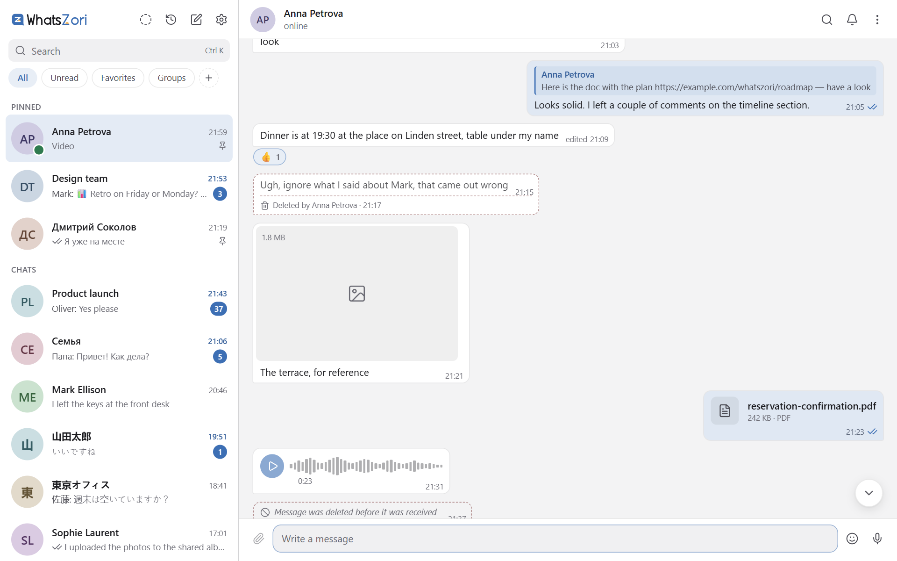
</picture>

</div>

---

WhatsZori is a native desktop app (Go + [Wails v3](https://v3.wails.io) + React) that links to
your phone like WhatsApp Web, through [whatsmeow](https://github.com/tulir/whatsmeow). Your
messages live in a local SQLite database on your computer, so nothing is lost when someone hits
*Delete for everyone*.

It's built in the spirit of AyuGram for privacy, and Vencord for themes and plugins.

## Features

### Nothing disappears

- **Anti-delete.** Messages deleted for everyone stay readable, marked with who deleted them and when.
- **Edit history.** Every earlier version of an edited message, one click away.
- **Deleted & edited** screen: all deletions and edits across every chat, newest first.
- **View once.** Photos and videos are kept and can be opened again and saved.
- **Statuses** are kept too, including ones the poster deleted, with *Save as…*.

### Ghost mode

- Hide your online status and *typing…*.
- Read receipts: always, never, or only when you reply.
- Hide the blue microphone when you listen to a voice note.
- **Ghost chats**: full ghost mode for just the chats you choose.
- **Ghost statuses**: view statuses without showing up in the viewer list. With it off,
  WhatsZori asks each time.

### Everything else you'd expect

- Chats, groups, replies, reactions, edits, deletes, photos, videos, video notes, GIFs, documents
- Send photos and files from a preview: paste with **Ctrl+V**, drop them on the chat, and
  **edit photos** first (crop, rotate, draw, arrows and shapes, text, blur)
- Voice notes: record and send, with a real waveform
- **Search** across all chats, and Ctrl+F inside one with highlighted matches
- **Polls**: live results, voters, and your own vote
- **Forward** to up to five chats, and multi-select to copy, forward or delete
- **Stickers**: make your own from any picture, resend ones from your chats
- A full **emoji picker** with search, categories, recents and skin tones
- New chat from your contacts or by phone number
- Contact and group info, members, shared media, links and documents
- Favourites and your own chat lists, pin, mute, archive, block
- Export chats to HTML, TXT or JSON, with media
- Native notifications on Windows, GNOME and KDE, or WhatsZori's own themeable cards
- Tray icon with an unread badge; close to tray and keep receiving messages

## Screenshots

<table>
  <tr>
    <td width="50%">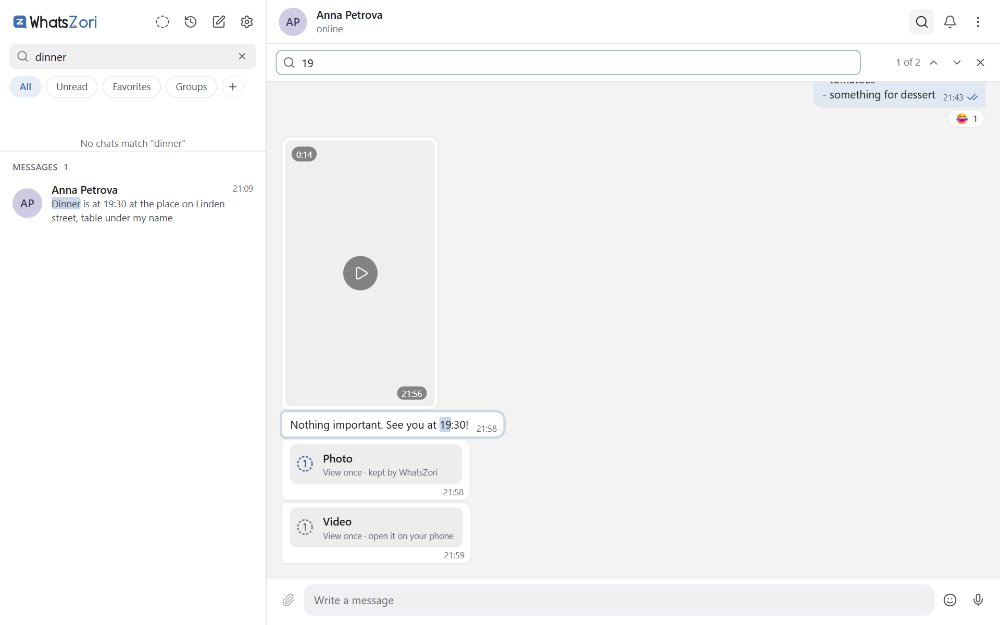<br><sub><b>Search</b>, across all chats and inside one</sub></td>
    <td width="50%">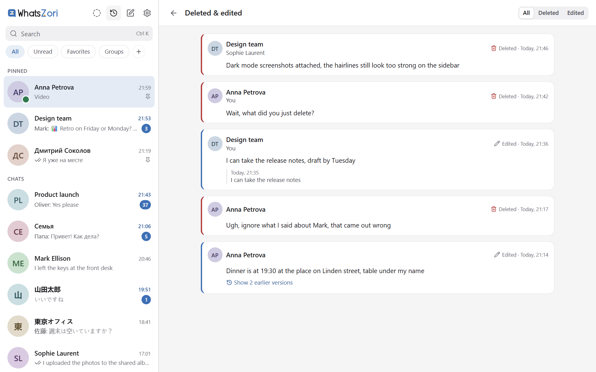<br><sub><b>Deleted &amp; edited</b>, with earlier versions</sub></td>
  </tr>
  <tr>
    <td>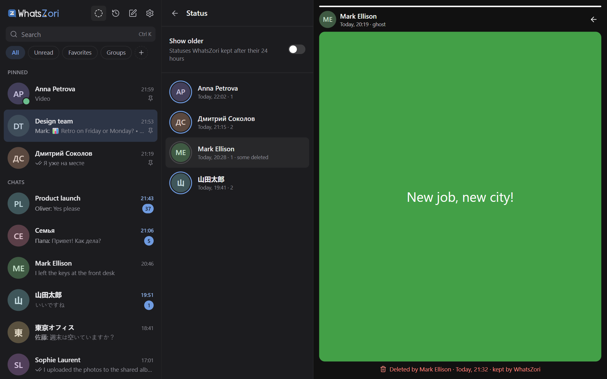<br><sub><b>Statuses</b>, deleted ones kept, viewed in ghost mode</sub></td>
    <td>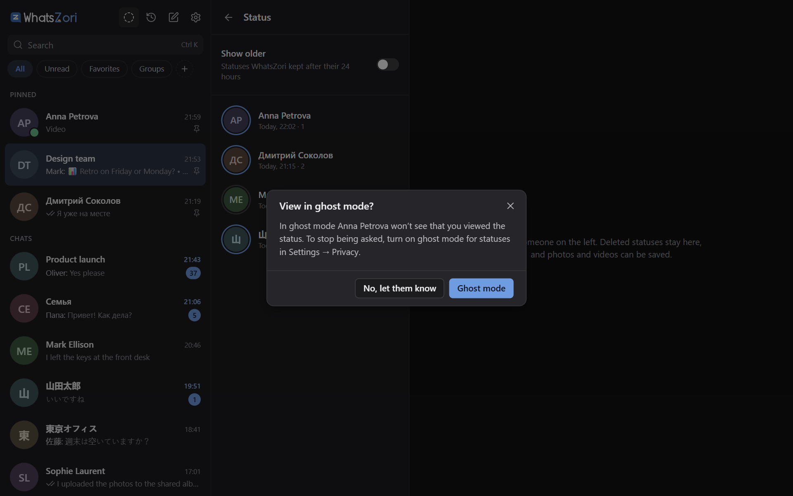<br><sub>Asked every time, unless ghost statuses are on</sub></td>
  </tr>
  <tr>
    <td>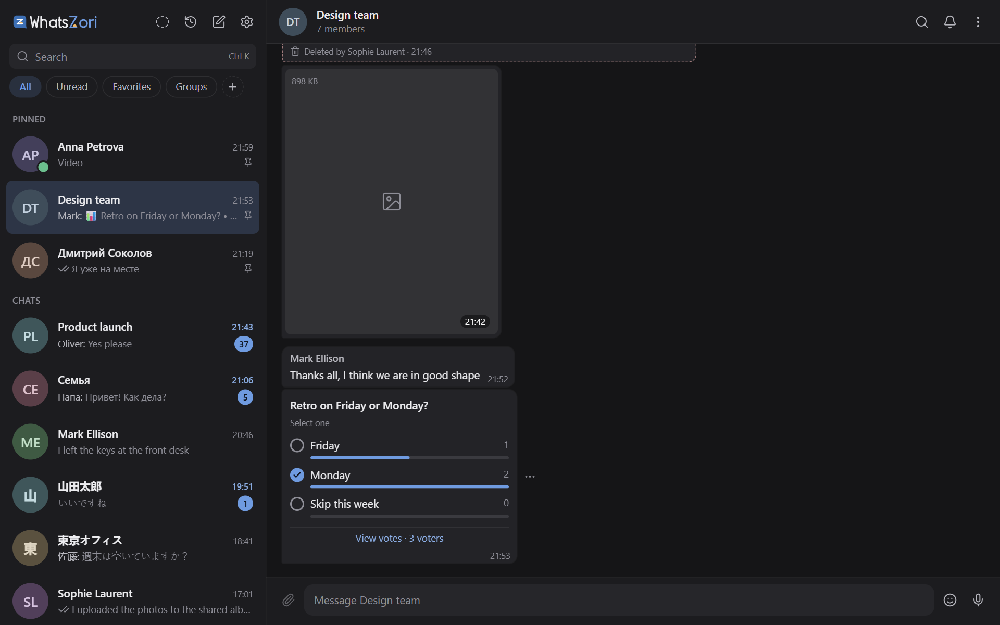<br><sub><b>Polls</b> with live results</sub></td>
    <td>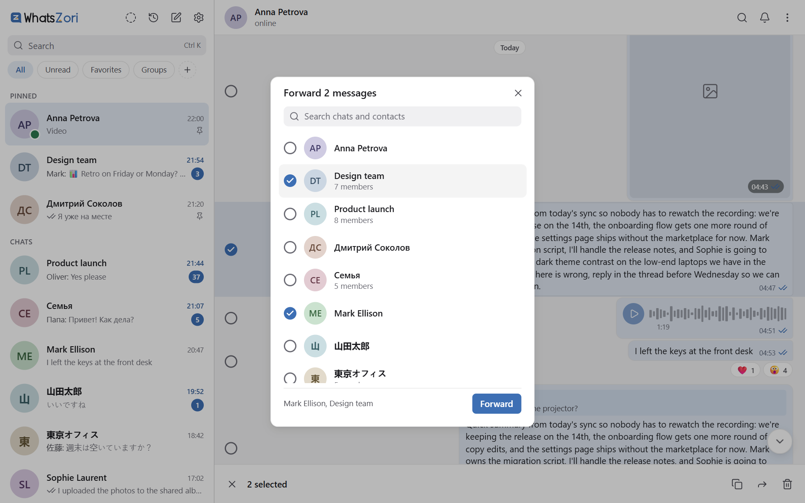<br><sub><b>Multi-select</b> and forward</sub></td>
  </tr>
  <tr>
    <td>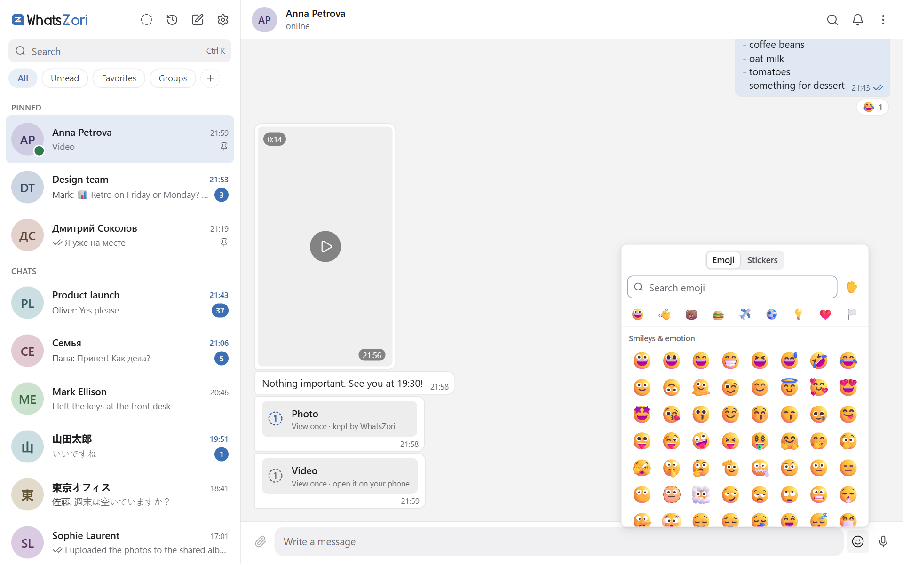<br><sub><b>Emoji</b> and <b>stickers</b> in one picker</sub></td>
    <td>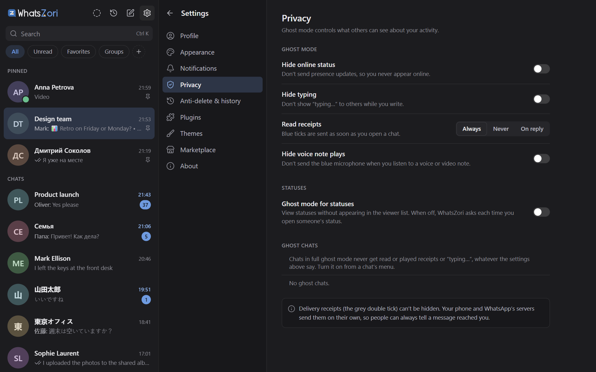<br><sub><b>Ghost mode</b>, down to single chats</sub></td>
  </tr>
</table>

<details>
<summary><b>Bundled themes</b></summary>
<br>
<table>
  <tr>
    <td width="33%">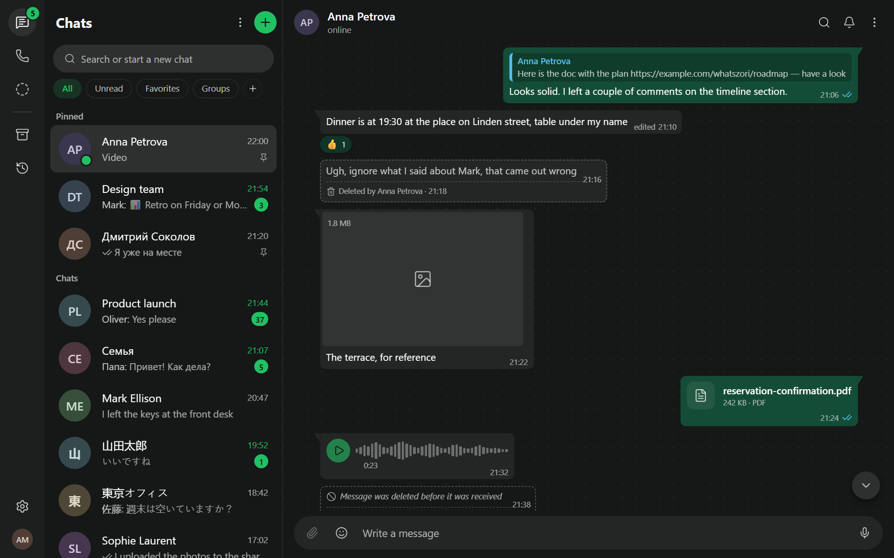<br><sub><b>Classic Green</b>: icon rail, tailed bubbles</sub></td>
    <td width="33%">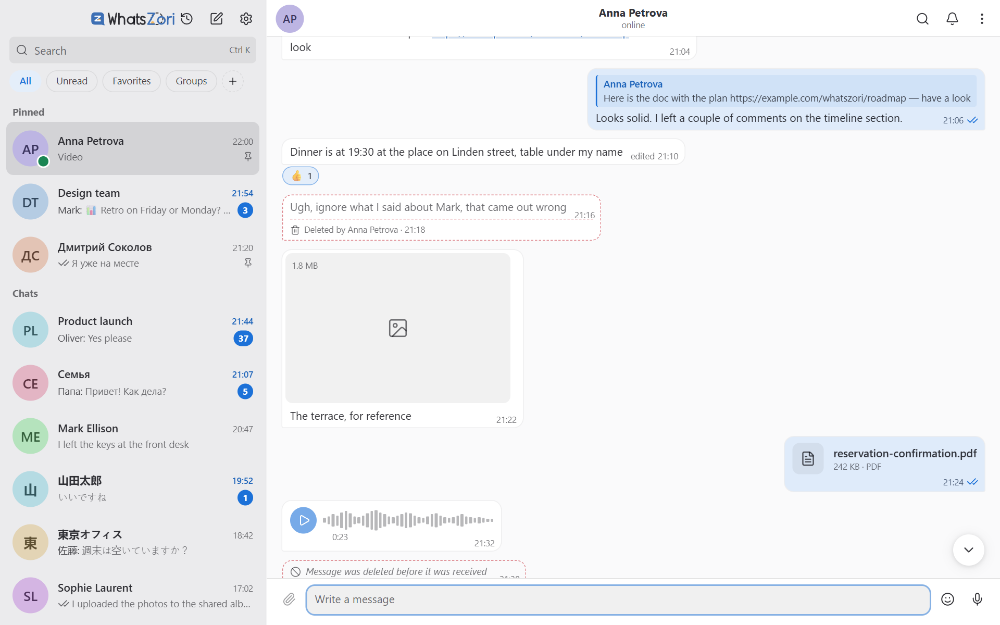<br><sub><b>Adwaita</b>: GNOME / libadwaita</sub></td>
    <td width="33%">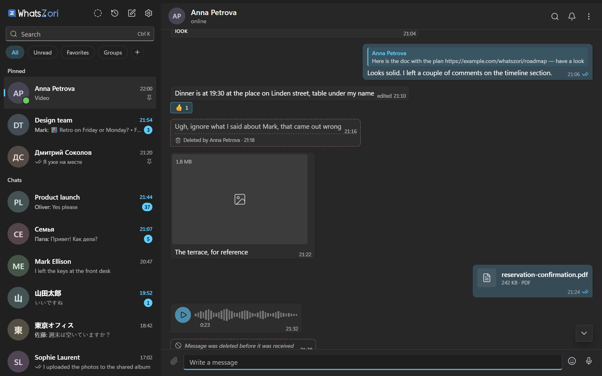<br><sub><b>WinUI</b>: Windows 11 / Fluent</sub></td>
  </tr>
</table>
</details>

## Getting started

### Download

Grab a build from [Releases](https://github.com/whatszori/WhatsZori/releases) once they are
published, or build it yourself, as below. Start it, then link it from your phone: **WhatsApp → Settings → Linked devices → Link a device**. You can
scan a QR code or enter a pairing code.

### Build from source

You need [Go 1.26+](https://go.dev/dl/), [Node.js 22+](https://nodejs.org) and the Wails 3 CLI:

```sh
go install github.com/wailsapp/wails/v3/cmd/wails3@latest
```

On Linux, also install GTK 4 and WebKitGTK 6 (for example, on Debian/Ubuntu:
`sudo apt install libgtk-4-dev libwebkitgtk-6.0-dev build-essential pkg-config`; for other distros
see [docs/WAILS.md](docs/WAILS.md)).

```sh
git clone https://github.com/whatszori/WhatsZori.git
cd WhatsZori
wails3 build          # → bin/WhatsZori(.exe)
```

| Command | What it does |
|---|---|
| `wails3 dev` | Runs with hot reload |
| `wails3 task check` | Go vet and tests, frontend typecheck, lint and tests |
| `cd frontend && npm run dev` | The interface alone in a browser, with demo data |

### Where your data lives

Everything stays in one folder on your computer:

| OS | Folder |
|---|---|
| Windows | `%AppData%\whatszori` |
| Linux | `~/.config/whatszori` |

It holds the session, `whatszori.db` (your messages), `media/`, `themes/`, `plugins/` and
`stickers/`.

Set `WHATSZORI_CONFIG_DIR` to use another folder, for example a second account. If a plugin or
theme breaks startup, run `WhatsZori --safe-mode`. WhatsZori also starts in safe mode on its own
after a crash.

## Themes and plugins

**Themes** are plain CSS on `--wz-*` variables. Drop a `.css` file or a theme folder into
`themes/` and switch it on in *Settings → Themes*. Edits apply as soon as you save. Theme folders
work like the bundled ones: a `manifest.json` with modules you can turn on and off. You can also
set your own chat wallpaper in *Settings → Appearance*.

```css
:root           { --wz-accent: #0b6bcb; --wz-bubble-out: #d7e9fb; }
[data-theme='dark'] { --wz-accent: #4aa3ff; --wz-bubble-out: #0f3a63; }
```

**Plugins** are ES modules in `plugins/<id>/`. They can:

- add buttons and menu items in fixed slots;
- show their own settings;
- store data;
- react to events.

Plugins can't send messages on their own: sending is always your click.

```js
export default {
  start(ctx) {
    const h = ctx.React.createElement;
    ctx.registerSlot('composer.actions', () =>
      h(ctx.ui.IconButton, { label: 'Wave', icon: '👋', onClick: () => ctx.actions.insertIntoComposer('👋') }),
    );
  },
};
```

See [docs/THEMING.md](docs/THEMING.md) and [docs/PLUGINS.md](docs/PLUGINS.md), plus the examples
in [`examples/`](examples/).

## Privacy and safety

- **Local first.** Messages, media and settings stay on your computer. There's no server, account
  or telemetry.
- **Not a bot.** WhatsZori is a client for a person:
  - there's no bulk sending, broadcasting or auto-replies;
  - a built-in rate limiter blocks sending the same text to many chats.

  Those things get accounts banned.
- **Logs** never contain message text, full phone numbers or keys.

> [!WARNING]
> WhatsZori is an unofficial client and isn't affiliated with WhatsApp or Meta. Using third-party
> clients is against WhatsApp's Terms of Service and may get your account restricted. Use it at
> your own risk.

## Documentation

| | |
|---|---|
| [STATUS.md](docs/STATUS.md) | What works today |
| [DECISIONS.md](docs/DECISIONS.md) | Why things are the way they are |
| [BACKEND.md](docs/BACKEND.md) | Go side: storage, ingest, privacy gate |
| [WAILS.md](docs/WAILS.md) | Desktop shell, builds, Linux packages |
| [THEMING.md](docs/THEMING.md) | Every `--wz-*` variable and stable class name |
| [PLUGINS.md](docs/PLUGINS.md) | Plugin API and slots |
| [MANUAL_TEST.md](docs/MANUAL_TEST.md) | What to check against a real account |

## Contributing

Issues and pull requests are welcome. Start with [CONTRIBUTING.md](CONTRIBUTING.md). Security
problems go privately, see [SECURITY.md](SECURITY.md).

## License

[MIT](LICENSE.md). WhatsZori builds on [whatsmeow](https://github.com/tulir/whatsmeow) (MPL-2.0),
[Wails](https://github.com/wailsapp/wails) (MIT),
[emojibase](https://github.com/milesj/emojibase) (MIT) and
[nativewebp](https://github.com/HugoSmits86/nativewebp) (MIT).
